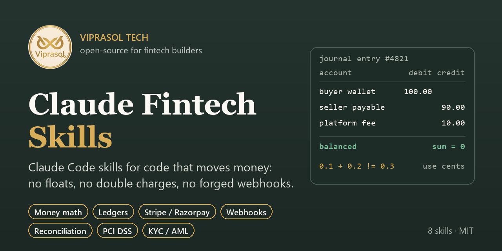

<div align="center">



### Claude Code skills for developers who build money software

**Money maths · double-entry ledgers · Stripe / Razorpay / PayPal / Adyen · webhooks · subscriptions · reconciliation · PCI DSS · KYC/AML**<br>
The mistakes that cost fintech teams money, caught while the code is being written.

[](https://github.com/Viprasol-Tech/claude-fintech-skills/stargazers)
[](LICENSE)
[](https://code.claude.com/docs/en/skills)
[](#-whats-inside)
[](https://github.com/Viprasol-Tech/claude-fintech-skills/actions/workflows/ci.yml)

[Quick start](#-quick-start) · [What's inside](#-whats-inside) · [Examples](#-just-ask) · [Scripts](#-bundled-scripts) · [Changelog](CHANGELOG.md)

</div>

---

## 💬 Just ask

Install once, then talk to Claude Code normally. The right skill loads by itself.

```text
> Review our checkout: can a customer ever be charged twice?
> Our Stripe webhook says "No signatures found matching the expected signature". Fix it.
> Design wallet balances for our marketplace - buyers, sellers, platform fee, payouts.
> Split ₹1,000 between three partners 50/30/20 without losing a paisa.
> Why doesn't yesterday's Stripe payout match our orders table? Here are both CSVs.
> We use Razorpay Subscriptions. Map every status to what the user can access.
> Are we SAQ A or SAQ A-EP with Stripe Elements plus Hotjar on the checkout page?
> Design sanctions screening and transaction monitoring for our remittance app.
```

## 📦 What's inside

| Skill | What it does |
| --- | --- |
| 🧮 **`money-math`** | Integer minor units or decimals, never floats; ISO 4217 exponents (JPY 0, KWD 3) **and where Stripe and Razorpay differ from ISO**; named rounding modes; splits that always sum to the total; FX, fees and tax. Cheat sheet for Python, JS/TS, Java, Go, C# and Postgres. |
| 📒 **`ledger-design`** | Double-entry ledgers for wallets, marketplaces and payouts: balanced, append-only entries, idempotent writes, pending vs. available funds, concurrency-safe balances. Includes a PostgreSQL schema. |
| 💳 **`payments-integration`** | Stripe, Razorpay, PayPal and Adyen without double charges: idempotency per provider, PaymentIntent and Razorpay state machines, SCA/3DS, capture, refunds, disputes, test vs. live keys, and fulfilment only from verified events. |
| 🔐 **`webhook-security`** | Stripe `t=`/`v1=` HMAC on the raw body, Razorpay webhook and Checkout signatures, PayPal CRC32 self-verification, Adyen HMAC, replay tolerance, dedupe and out-of-order events. Ships a local signature checker. |
| 🔁 **`subscription-billing`** | Status-to-access mapping, proration, usage-based billing, dunning, SCA renewals, tax and invoices, and entitlement sync that survives missed webhooks. |
| ⚖️ **`reconciliation`** | Three-way match of ledger, provider balance transactions and bank payouts, with a tested matcher and a table of why payouts don't equal sales. |
| 🛡️ **`pci-scope`** | PCI DSS v4.0.1: which SAQ your integration lands in, the **2025 SAQ A script rule**, what you may never store, BIN + last-four masking, payment-page script controls, and the scope leaks in logs, Sentry and session replay. |
| 🕵️ **`kyc-aml-flows`** | Engineering checklist for onboarding, sanctions screening (OFAC 50% rule, fuzzy matching, re-screening), monitoring, case management, report deadlines and retention for the US, EU, India and UK, **checked in November 2026**. |

Provider, PCI and AML facts are taken from official sources (Stripe, Razorpay,
PayPal and Adyen docs, the PCI SSC, FinCEN, OFAC, EUR-Lex, RBI, FIU-IND, NCA,
FATF) and linked inside each skill.

## ⚡ Quick start

**Option A: Claude Code plugin (recommended)**

```bash
claude plugin marketplace add Viprasol-Tech/claude-fintech-skills
claude plugin install fintech-studio@claude-fintech-skills
```

Skills are then available as `/fintech-studio:<skill>` and load automatically
when your request matches.

Want every Viprasol plugin? Add the [Viprasol marketplace](https://github.com/Viprasol-Tech/claude-plugins) once:
`claude plugin marketplace add Viprasol-Tech/claude-plugins`, then
`claude plugin install <plugin>@viprasol`.

**Option B: installer** (copies the skills to `~/.claude/skills`)

```bash
git clone https://github.com/Viprasol-Tech/claude-fintech-skills
cd claude-fintech-skills
bash install.sh                                        # macOS / Linux
powershell -ExecutionPolicy Bypass -File install.ps1   # Windows
```

No API keys, no accounts, no network calls. The scripts need only Python 3.10+.

## 🧰 Bundled scripts

Standard-library Python with built-in self-tests, so Claude calculates instead
of guessing.

**`money.py`** - exact money arithmetic:

```text
$ python money.py allocate 10000 USD 1 1 1
3334 3333 3333
$ python money.py to-minor 19.999 USD
error: 19.999 has more than 2 decimal places for USD
$ python money.py split-tax 11800 INR --rate 18 --inclusive
net   10000
tax   1800
gross 11800
```

**`recon.py`** - ledger vs. provider or bank, one-to-one, with an exceptions report:

```text
$ python recon.py ledger.csv stripe.csv --right-amount amount_cents --right-scale 0.01 --days 2 ...
matched         2
amount_mismatch 1
unmatched_right 1
difference      -11.00
```

**`verify_webhook.py`** - find out *why* a signature fails:

```text
$ python verify_webhook.py stripe --body raw.json --header "$SIG" --secret whsec_test_...
FAIL: signature mismatch: wrong secret (test vs live, CLI vs Dashboard), or the body was parsed/re-serialised before verification
```

## 🗂️ Repository layout

```text
.claude-plugin/marketplace.json          marketplace manifest
plugins/fintech-studio/
  .claude-plugin/plugin.json             plugin manifest
  skills/<skill>/SKILL.md                one folder per skill
  skills/money-math/scripts/money.py
  skills/reconciliation/scripts/recon.py
  skills/webhook-security/scripts/verify_webhook.py
  skills/kyc-aml-flows/reference.md      jurisdiction table with sources
tests/validate_repo.py                   CI: manifests, frontmatter, links, scripts
```

## ⚠️ Disclaimer

These skills are **engineering guidance**, not legal, compliance, tax or
accounting advice. PCI DSS validation is decided by your acquirer and assessor,
and AML/KYC obligations depend on your licence and jurisdiction; confirm with
qualified professionals. Regulations and provider APIs change; check the linked
sources before relying on a threshold or deadline. Use test-mode keys and
synthetic data, and never paste live secrets or customer data into a chat.
Viprasol Tech is not affiliated with Stripe, Razorpay, PayPal, Adyen, the PCI
SSC, Anthropic or any regulator mentioned here.

## 🤝 Contributing

Corrections with a link to the official source are the most valuable
contribution: payment APIs and regulations change. See
[CONTRIBUTING.md](CONTRIBUTING.md) and run `python tests/validate_repo.py`
before opening a PR. More free Claude Code packs from Viprasol:
[claude-ml-trading-skills](https://github.com/Viprasol-Tech/claude-ml-trading-skills) ·
[claude-ai-trading-agent-skills](https://github.com/Viprasol-Tech/claude-ai-trading-agent-skills) ·
[claude-market-data-skills](https://github.com/Viprasol-Tech/claude-market-data-skills) ·
[claude-prop-firm-skills](https://github.com/Viprasol-Tech/claude-prop-firm-skills) ·
[claude-options-trading-skills](https://github.com/Viprasol-Tech/claude-options-trading-skills) ·
[claude-tradingview-automation-skills](https://github.com/Viprasol-Tech/claude-tradingview-automation-skills) ·
[claude-crypto-bot-skills](https://github.com/Viprasol-Tech/claude-crypto-bot-skills) ·
[claude-voice-agent-skills](https://github.com/Viprasol-Tech/claude-voice-agent-skills) ·
[claude-india-stack-skills](https://github.com/Viprasol-Tech/claude-india-stack-skills) ·
[claude-trading-skills](https://github.com/Viprasol-Tech/claude-trading-skills) ·
[claude-video-editing-skills](https://github.com/Viprasol-Tech/claude-video-editing-skills).

## 📬 Contact — Viprasol Tech Private Limited

Building a wallet, payments platform, lending product or marketplace? We
design and build fintech systems that reconcile to the cent.

- 🌐 Website: [viprasol.com](https://viprasol.com)
- ✉️ Email: [support@viprasol.com](mailto:support@viprasol.com)
- 💬 Telegram: [t.me/viprasol_help](https://t.me/viprasol_help) · 📱 WhatsApp: +91 96336 52112
- 🐙 GitHub: [@Viprasol-Tech](https://github.com/Viprasol-Tech) · 💼 [LinkedIn](https://www.linkedin.com/in/viprasol/) · 𝕏 [@viprasol](https://twitter.com/viprasol)

## License

[MIT](LICENSE) © 2026 Viprasol Tech Private Limited
